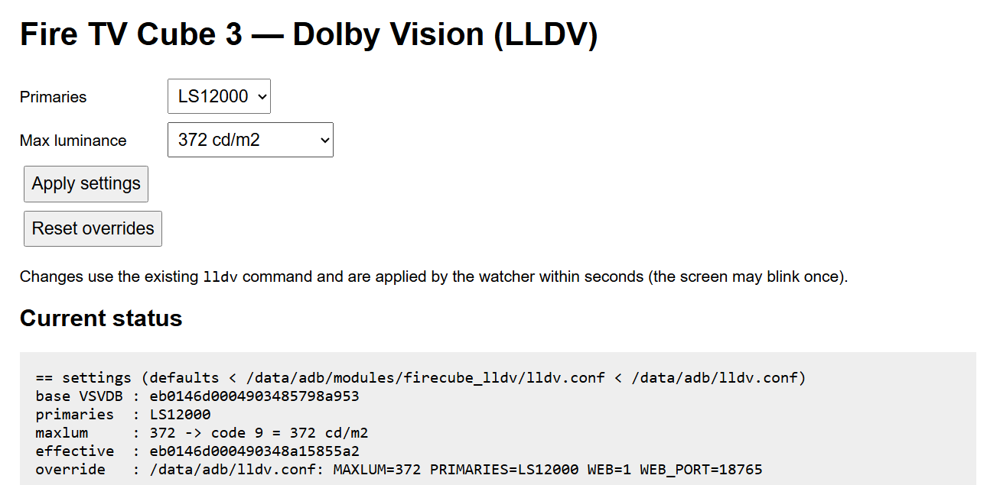
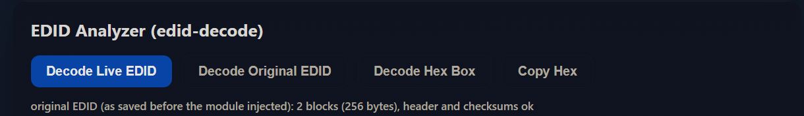

# Fire TV Cube 3: Dolby Vision (LLDV) on non-DV displays

A Magisk module for a **rooted Fire TV Cube 3rd gen ("gazelle")**. When the connected display does not report Dolby
Vision, the module adds a Dolby Vision VSVDB to the EDID the Cube works from, so the Cube offers **low-latency Dolby
Vision (LLDV)** to a display that cannot do DV itself (a projector, for example). It re-applies the change after
hotplug, standby wake and boot, and leaves real Dolby Vision displays alone.

Current version: **v0.4.0** (see [Revision history](#revision-history)). Tested on Fire OS 7.7.1.7 (PS7717/5741),
kernel 5.4.125-ab25, Magisk 30.7.

> Unofficial, no warranty, you need root. The module changes the EDID the Cube's kernel works from; a boot-loop guard
> disables it after 4 unstable boots in a row.

## How it works

1. The Cube's kernel parses the display's EDID and exposes the result in `/sys/class/amhdmitx/amhdmitx0/`
   (`dv_cap2`, `hdr_cap`, `rawedid`, ...). The `edid` node can `save` the live EDID to a file and `load` one back.
2. When `dv_cap2` says the display has no Dolby Vision, the watcher saves the live EDID, **appends one extra CTA
   extension block that contains only the Dolby VSVDB**, fixes the block count and checksums, and loads it back.
   Appending a block (not editing the existing one) matters because many displays' CTA blocks are full and have no
   room for the 12-byte VSVDB. The kernel parser walks every CTA block, so a separate block always works.
3. Android only re-reads the display capabilities on a plug event, so after loading the watcher cycles
   `fake_plug` 0 then 1 (a short screen blink).
4. A loaded EDID is thrown away whenever the kernel re-reads the display (hotplug, and also a standby wake **with no
   plug event at all**). So the watcher polls the *state* every 2 s instead of waiting for events, and re-injects.

All writes to the kernel's `edid` node are exactly 16 bytes with no newline, at fixed paths on `/dev`, and only a
handful are made per injection. Implementation details and device quirks are in [AGENT.md](AGENT.md).

## Requirements

- Fire TV Cube 3rd gen (`ro.product.device` = `gazelle`), rooted with Magisk 20.4 or newer (tested with 30.7).
- The installer refuses other devices and firmware without `/sys/class/amhdmitx/amhdmitx0/dv_cap2`.
- The optional browser UI uses the BusyBox `httpd` bundled with Magisk (`/data/adb/magisk/busybox`, present in
  normal Magisk installs; confirmed v1.36.1.1). No extra packages are needed. Without Magisk's BusyBox the rest of
  the module still works, but the browser UI will not start.

## Install

The ready-built module is [`dist/firecube_lldv-v0.4.0.zip`](dist/firecube_lldv-v0.4.0.zip) (about 222 KB), version
v0.4.0. Its SHA-256 is in [`dist/SHA256SUMS`](dist/SHA256SUMS); check the download with
`sha256sum -c dist/SHA256SUMS` (Linux/macOS/WSL) or `Get-FileHash dist\firecube_lldv-v0.4.0.zip` (PowerShell). The
build is reproducible: `python3 tools/build_zip.py module dist/firecube_lldv-v0.4.0.zip` regenerates the same bytes.

Install it from the Magisk app (Modules, Install from storage) or, over adb (this is the route used in testing):

```
adb push dist/firecube_lldv-v0.4.0.zip /data/local/tmp/
adb shell su -c "magisk --install-module /data/local/tmp/firecube_lldv-v0.4.0.zip"
```

Reboot. In testing the watcher started about 8 s after `service.sh` and had injected about 25 s after it. Check with:

```
adb shell su -c /data/adb/modules/firecube_lldv/lldv show
```

## Settings

Defaults: base block `eb0146d0004903485798a953` (VSVDB v2, low-latency only, YCbCr 4:2:2 12-bit, BT2020 primaries),
`MAXLUM=385`, primaries as in the base block (`BT2020`). Layers, later wins: built-in defaults, the module's `lldv.conf`,
`/data/adb/lldv.conf` (your overrides, survive module updates).

The `lldv` command (run as root) changes them. The running watcher picks the change up within seconds and re-injects
(one screen blink); no reboot.

| Command | Effect |
|---|---|
| `lldv show` | settings, what the display reports, watcher state, last log lines |
| `lldv list` | the selectable maxLum values and primaries presets |
| `lldv set maxlum <cd/m2>` | peak luminance; snaps to the nearest of 32 steps; `0` keeps the base block's value |
| `lldv set primaries <name>` | `BT709`, `BT2020`, `DCI-P3`, `LS12000`, or `base` (keeps the base block's primaries, which are `BT2020` by default) |
| `lldv set hdr_infoframe on\|off` | send a CTA-861.3 HDR10 (SMPTE ST 2084 PQ) DRM InfoFrame in hardware Bank 6 whenever the Cube outputs LLDV (`off` by default) |
| `lldv set web enabled[:port]` | enable the browser UI; optional port defaults to `18765` and is written to `/data/adb/lldv.conf` |
| `lldv cycle` | next primaries preset |
| `lldv reset [maxlum\|primaries\|hdr_infoframe]` | remove the override(s) |
| `lldv edid [orig]` | the EDID as hex, 16 bytes per line, to paste into an EDID analyzer (see below) |
| `lldv log [n]` | tail of `/data/local/tmp/lldv.log` |

Example: `su -c /data/adb/modules/firecube_lldv/lldv set primaries DCI-P3`

### EDID dump

**`lldv edid`** prints the live EDID the kernel holds now, which includes the injected block (3 blocks, 384 bytes,
when the module has injected). When the Cube is in standby (`rawedid` is cleared to 128 zero bytes by the HDMI driver),
`lldv edid` falls back to `/dev/lldv_p` (the last patched EDID the watcher loaded) and notes this in the summary line.
`lldv edid orig` prints the display's own EDID as the module saved it just before
injecting; it only exists after an injection since boot. Only hex goes to stdout, so `lldv edid > edid.txt` captures
just the hex; a one-line summary (block count, header, per-block checksums, with `BAD HEADER` / `BAD CHECKSUM`
flagged) goes to stderr. It only reads; it never writes to the kernel's `edid` node.

```
00 FF FF FF FF FF FF 00 34 A3 01 00 01 00 00 00
04 19 01 03 80 73 41 78 0A CF 74 A3 57 4C B0 23
...
```

The output is uppercase, space-separated hex, which analyzers that take a hex dump accept directly. For example,
paste it into the online [edid-decode](https://hverkuil.home.xs4all.nl/edid-decode/edid-decode.html) and process it:
the injected block shows up as `Vendor-Specific Video Data Block (Dolby), OUI 00-D0-46`, with the version, interface,
Target Max PQ and the `Unique Rx, Ry` / `Gx, Gy` / `Bx, By` primaries the Cube advertises.

To turn the dump back into a binary file on the Cube, lowercase it first (`tr 'A-F' 'a-f'`): the Cube's `xxd -r -p`
skips uppercase hex.

### maxLum and primaries

**maxLum** is a 5-bit field, so only these 32 values exist (cd/m2): 94 110 129 150 175 204 237 276 320 372 431 499
578 670 775 897 1037 1200 1387 1605 1856 2147 2485 2876 3330 3857 4470 5183 6014 6982 8113 9434. `385` becomes `372`
(code 9, the value in the base block). Other tools label code 9 as "385"; the code in the EDID is what counts.

**Primaries** are stored in 1/256 steps, rounded down. This matches a known-good LS12000 calibration EDID bit for
bit (`captures/ls12000_known_good.txt`); the default base block's primaries are BT2020 rounded down too:

| Preset | Requested (Rx Ry / Gx Gy / Bx By) | Stored |
|---|---|---|
| BT709 | .6400 .3300 / .3000 .6000 / .1500 .0600 | .6367 .3281 / .2969 .5977 / .1484 .0586 |
| BT2020 | .7080 .2920 / .1700 .7970 / .1310 .0460 | .7070 .2891 / .1680 .7969 / .1289 .0430 |
| DCI-P3 | .6800 .3200 / .2650 .6900 / .1500 .0600 | .6797 .3164 / .2617 .6875 / .1484 .0586 |
| LS12000 Native | .6670 .3310 / .3140 .6720 / .1480 .0420 | .6641 .3281 / .3125 .6719 / .1445 .0391 |

With the default base block, `BT2020` therefore gives the same VSVDB as `base` (nothing is re-injected).

Each coordinate has a limited reachable range in a v2 block (blue only 8 steps per axis); see
`module/lldv_gamut.sh`. The v2 block has no white-point field.

You can also edit `/data/adb/lldv.conf` by hand (`VSVDB=`, `MAXLUM=`, `PRIMARIES=`, `HDR_INFOFRAME=`, `POLL=`,
`SETTLE=`, `HOLDOFF=`). It is sourced as shell, so it is ignored unless owned by root and not group/world-writable.

### Forcing the display's HDR EOTF (HDR10 InfoFrame)

Spoofing LLDV has two sides:
1. **The player (Cube)** sees the injected Dolby Vision VSVDB in the EDID and outputs player-led LLDV (12-bit YCbCr 4:2:2, BT.2020, dynamically tone-mapped to `maxLum`) with a Dolby Vision Vendor-Specific InfoFrame (VSIF, OUI `00-D0-46`) in hardware InfoFrame Bank 8.
2. **The display** needs to use its HDR (SMPTE ST 2084 PQ) EOTF curve. Because `hdmitx_set_vsif_pkt()` disables hardware InfoFrame Bank 6 (the standard CTA-861.3 HDR10 Dynamic Range & Mastering InfoFrame) when entering LLDV, an HDR10-only display that ignores the Dolby VSIF will stay in SDR unless you either force HDR EOTF on the display (e.g. Epson LS12000) or send an HDR10 DRM InfoFrame alongside the LLDV signal (what an external HDFury box does).

On the Cube 3, the HDMI transmitter (`hdmitx21`) has independent hardware InfoFrame banks (`TPI_INFO_FSEL_IVCTX`, registers `0x06BF..0x06DF`), so **Bank 6 (HDR10 DRM InfoFrame) and Bank 8 (Dolby Vision LL VSIF) can transmit simultaneously**. If your display cannot manually force its HDR EOTF, enable `HDR_INFOFRAME`:

```
su -c '/data/adb/modules/firecube_lldv/lldv set hdr_infoframe on'
```

(or set **HDR10 InfoFrame** to `on` in the browser UI). When enabled (`HDR_INFOFRAME=1`, off by default), the watcher monitors `/sys/class/amhdmitx/amhdmitx0/hdmi_hdr_status`:
- Whenever `hdmi_hdr_status` is `DolbyVision-Lowlatency`, it loads a CTA-861.3 HDR10 DRM InfoFrame (`87 01 1a 5c 02 00 ...`, `EOTF = 2` SMPTE ST 2084 PQ, static metadata left `0` = unspecified so the display does not double-tone-map the already-tone-mapped LLDV signal) into Bank 6 and enables hardware repeat (`0xE0`).
- When `hdmi_hdr_status` leaves `DolbyVision-Lowlatency` (e.g. switches to `SDR` in adaptive mode) or when you run `lldv set hdr_infoframe off`, Bank 6 is cleared back to `0`.

### Optional browser UI

A small browser page is available for changing primaries and maxLum without `adb`. It is **disabled by default**.
The easiest way to enable it is to let `lldv set web` create `/data/adb/lldv.conf` for you:

```
su -c '/data/adb/modules/firecube_lldv/lldv set web enabled'
su -c '/data/adb/modules/firecube_lldv/lldv set web enabled:18765'
```

The first form uses port `18765`; the second writes a specific port. Both create or update root-owned mode `600`
`/data/adb/lldv.conf` with `WEB=1` and `WEB_PORT=<port>`, preserving the existing `MAXLUM`, `PRIMARIES`, and timing
settings. You can also configure it by hand:

```
WEB=1
WEB_PORT=18765
```

Reboot, or start it immediately with `su -c 'sh /data/adb/modules/firecube_lldv/lldv_web.sh'`. Then open
`http://<cube-address>:18765/` in a phone, tablet or PC browser.

The page includes:
- **Settings**: Primaries (`base (BT2020)`, `BT709`, `BT2020`, `DCI-P3`, `LS12000`), Max luminance (`0` or any of the 32 steps), and HDR10 InfoFrame (`off` or `on`), plus a **Reset overrides** button.
- **Current status**: Full `lldv show` output (version, settings, display state, watcher PID, and recent log lines).
- **EDID Analyzer (`edid-decode`)**: Bundles the WebAssembly build of `v4l-utils` [`edid-decode`](https://hverkuil.home.xs4all.nl/edid-decode/edid-decode.html) (`edid-decode.js` + `edid-decode.wasm`) locally in `module/www/` so your browser decodes the **Live EDID** or **Original EDID** (or any pasted hex) inline on the page with zero copy-paste and zero CPU load on the Cube.

**Security:** the page has **no authentication and no encryption**. Anyone on your local network who can open it
can change primaries and maxLum. Enable it only on a network you trust, and never expose the port to the internet.
Set `WEB=0` and reboot to disable it. The page never writes to the kernel's `edid` node directly; it uses the
existing `lldv` command, and only accepts the listed primaries and luminance values.

## Testing

Tested on the Cube:

| Tested | How |
|---|---|
| Injection at boot | module installed, rebooted, watcher injected on its own |
| Injection after a cable pull and replug | log and kernel events |
| Display switched from DV to non-DV | no injection while the display reported DV; one injection after the switch |
| Standby wake | kernel re-read the EDID at late resume with no plug event; watcher re-injected about 5 s later |
| Live settings change (`lldv set`, `lldv cycle`) | each change re-injected the new block, no reboot |
| All four primaries presets and maxLum (v0.2.2) | the VSVDB the kernel reports matches the expected bytes for every preset, DCI-P3 + maxLum 1000 and a bad preset name (`captures/test82_watch4_v022.txt`) |
| Boot-loop guard counting and its 5-minute clear | real boots |
| Shell code on the device (v0.4.0) | 104 unit checks pass under both the adb shell and Magisk's busybox ash, including `lldv show` version output, `lldv set web enabled[:port]`, `lldv set hdr_infoframe on\|off`, `lldv edid` standby fallback, and the watcher's sysfs readers on CRLF, empty and missing files (`captures/test110_units_hdr_if.txt`); 17 primaries checks pass (`captures/test81_gamut_v022.txt`, the primaries code is unchanged since v0.2.2) |
| Action button (v0.2.3+) | prints the version, settings, status, log and example commands, and leaves `/data/adb/lldv.conf` unchanged (`captures/test95_action_v023.txt`) |
| Watcher pass on the new code (v0.2.3) | a single `--once` pass under both shells reads the display state and exits cleanly (`captures/test97_once_v023.txt`) |
| Browser UI (v0.3.x–v0.4.0) | GET/POST (including `hdr_infoframe`) and `?edid=live`/`?edid=orig` work from the PC; version heading and EDID analyzer card verified; invalid values are rejected; reset and duplicate-start protection work; CGI passes under both shells and the real override is unchanged (`captures/test98_web_v030.txt`, `test102_web_v031.txt`, `test107_web_v032.txt`, `test108_web_edid.txt`, `test111_web_hdr_if.txt`) |
| HDR10 InfoFrame injection (v0.4.0) | `lldv set hdr_infoframe on` / watcher enables hardware InfoFrame Bank 6 (`87 01 1a 5c 02 ...`) alongside Bank 8 (Dolby Vision LL VSIF) while `hdmi_hdr_status` remains `DolbyVision-Lowlatency`, and `reset hdr_infoframe` clears Bank 6 back to `0` (`captures/test112_live_hdr_if.txt`) |
| Browser UI boot tests (v0.3.x) | real reboots with `WEB=1`: the listener starts from `service.sh`, one watcher and one `httpd`; a browser POST changed primaries and the watcher re-injected the matching VSVDB; config then restored and the listener stopped (v0.3.0: `captures/test100_boot_web_v030.txt`, `test101_restore_v030.txt`; v0.3.1, no auth: `test104_boot_web_v031.txt`, `test105_restore_v031.txt`) |
| `lldv edid` | output round-trips byte-for-byte to the EDID file the watcher loaded and to the saved original |

## Troubleshooting and removal

- Log: `/data/local/tmp/lldv.log` (also `lldv log`). State: `lldv show`.
- Boot-loop guard: after 4 unstable boots in a row (uptime under 5 minutes) it creates
  `/data/adb/modules/firecube_lldv/disable` and logs why. Remove that file and reboot to re-enable.
- Stop temporarily: `touch /data/adb/modules/firecube_lldv/disable` and reboot.
- Uninstall: Magisk app, or `touch /data/adb/modules/firecube_lldv/remove` and reboot. The display's own EDID is back
  after the next hotplug or reboot. `/data/adb/lldv.conf` is left in place on purpose.

## Repository layout

| Path | What |
|---|---|
| `module/` | the Magisk module (what goes in the zip) |
| `module/lldv_watch.sh` | the watcher; `lldv_edid.sh` EDID patcher; `lldv_lum.sh` maxLum; `lldv_gamut.sh` primaries; `lldv_cfg.sh` settings; `lldv_guard.sh` boot-loop guard |
| `module/lldv`, `action.sh` | the settings command and the Magisk Action button (read-only: shows the settings, status, recent log and example commands) |
| `module/lldv_web.sh`, `module/www/` | optional browser UI and local WebAssembly `edid-decode` analyzer (disabled unless `WEB=1`; no authentication, local network only) |
| `tools/` | `build_zip.py`, `dv_vsvdb.py` (VSVDB decoder, maxLum table, gamut reference encoder), `edid_tool.py` |
| `tools/dev/` | scripts pushed to `/data/local/tmp` and run as root on the Cube during development (tests, status, probes) |
| `tools/wsl/` | scripts that run in WSL/Linux (extract Amazon's source, regenerate reports) |
| `dist/` | the built module zip for the current version, plus `SHA256SUMS` |
| `captures/` | curated evidence from the Cube (the original EDID, probe results, test results) |
| `AGENT.md` | notes for AI coding agents and future maintainers |

`dist/` holds the current release zip and its `SHA256SUMS`. `src/` (Amazon's 2 GB kernel source tarball and the files
read from it) is not tracked, and neither are older dev builds of the zip.

## Reference source

Amazon publishes the kernel source for the Cube 3: `FireTVCubeGen3-7.7.1.4-20260624.tar.bz2` from
`https://fireos-tv-src.s3.amazonaws.com/C4PWIMXUTMxbwcQ2xRkOmIeodX/` (about 2 GB). The kernel is inside the nested
`platform.tar`, under `kernel/amlogic/pop1g/5.4/common/`. The relevant files are
`drivers/amlogic/media/vout/hdmitx21/hdmi_tx_edid.c` and `hdmi_tx_main.c`, and
`include/linux/amlogic/media/vout/{vinfo.h,hdmi_tx21/*.h}`. `tools/wsl/` automates the extraction. The tarball is
7.7.1.4 and the tested device runs 7.7.1.7. I only relied on the VSVDB bit layout, and checked it against the device:
the VSVDB the kernel reports after every injection matched the bytes the module built.

A kernel-module approach (hooking `hdmitx21_edid_parse` with a kretprobe to patch the parsed DV info in memory) was
investigated and not built. The kernel config has KPROBES and no `CONFIG_MODULE_SIG`, but it is built with CFI,
ShadowCallStack, MODVERSIONS and ThinLTO, so a module would need the exact toolchain and carries a real risk of a
crash. The EDID route needs none of that.

## Revision history

| Version | Changes |
|---|---|
| v0.4.0 | Added optional **HDR10 InfoFrame (`HDR_INFOFRAME=1`)** (`lldv set hdr_infoframe on\|off`, `lldv reset hdr_infoframe`, and Web UI dropdown) to transmit a CTA-861.3 HDR10 (SMPTE ST 2084 PQ) Dynamic Range & Mastering InfoFrame in hardware InfoFrame Bank 6 alongside the Dolby Vision LL VSIF in Bank 8 whenever `hdmi_hdr_status` is `DolbyVision-Lowlatency`, allowing HDR10-only displays without a manual EOTF override to automatically switch into HDR mode (104 unit checks per shell). |
| v0.3.4 | Browser UI: styled with dark slate theme, 64×64 favicon, `base (BT2020)` primaries label, and bundled local `edid-decode` WebAssembly (`edid-decode.js` + `edid-decode.wasm`) to decode the live or original EDID inline on the page. `lldv edid` now falls back to `/dev/lldv_p` when the kernel's `rawedid` is all zeros in standby (97 unit checks per shell). |
| v0.3.3 | Added module version display to `lldv show` and the browser UI heading; added `lldv set web enabled:18765` to the Action button and installer command hints; added unit tests for `lldv set web` and version output (94 checks per shell). |
| v0.3.2 | `lldv set web enabled[:port]` creates `/data/adb/lldv.conf` with `WEB=1` and `WEB_PORT=<port>`, preserving existing settings. Port defaults to 18765 and must be 1024–65535. |
| v0.3.1 | Browser UI: authentication removed (the page now has no login at all, for trusted local networks only). BusyBox `httpd` requirement documented in Requirements. |
| v0.3.0 | Optional password-protected browser UI (`WEB=1`, disabled by default) for primaries, maxLum and reset. It uses the existing `lldv` command, accepts only fixed values, redacts `WEB_PASS`, and is unencrypted HTTP on the local network. |
| v0.2.3 | After loading the patched EDID the watcher re-checks for DV twice (2 s apart) instead of once, and if the kernel still reports no DV it **keeps the patched EDID loaded** (it used to restore the display's own EDID, which left the Cube without DV until the next hotplug or reboot); it logs a `WARN` and backs off, so the `edid` node is not hammered. A poll pass starts far fewer processes (the effective VSVDB is cached, sysfs nodes are read with shell builtins): about 0.9% to about 0.55% of the Cube's CPU. The Magisk **Action** button is now read-only: it shows the version, settings, display and watcher state, the last log lines and example `su` commands, and no longer steps the primaries (use `lldv cycle`). |
| v0.2.2 | `PRIMARIES` presets round down to the 1/256 step instead of to the nearest one, matching a known-good LS12000 calibration EDID bit for bit. New preset blocks: BT709 `…99321ea7`, BT2020 `…5798a953` (same as the default base block), DCI-P3 `…8760768f`, LS12000 `…a15855a2`. |
| v0.2.1 | New read-only `lldv edid [orig]` command: prints the live (or the display's original) EDID as hex for an EDID analyzer. |
| v0.2.0 | First release: state-polling watcher, extra CTA block with the Dolby VSVDB, re-injection after boot, hotplug and standby wake, maxLum and primaries settings, `lldv` command and Magisk Action button, boot-loop guard. |

## License

No license has been chosen yet.
